# Optimized Operation of Thermal Power Cogeneration Microgrid Based on Multi-energy Complementarity (Matlab Code Implementation)

​  
Editor
Abstract: The cogeneration microgrid (CHP-MG) plays an important application value in achieving sustainable energy development and constructing a green and low-carbon society. However, the internal complex energy structure and equipment coupling relationship also bring challenges to its operation optimization. By utilizing the interactive complementary relationship between electricity and heat supply and demand, the thermal decoupling of cogeneration equipment on the supply side is realized by using energy storage devices. Through the enhancement of system's multi-energy supply capacity through various energy conversion equipment. On the demand side, load types are classified, and the elasticity of electrical loads and the diversity of system heating methods are utilized to construct a comprehensive energy demand response model that includes time-shifted electric load, reduction response, and thermal load supply mode responses. A response compensation mechanism is proposed. Based on this, the objective is to minimize the sum of system operational costs and response compensation costs, taking into account the constraints of device operation on both sides of supply and demand, to establish a mathematical model for the optimized operation of CHP-MG based on multi-energy complementarity. Simulation results and comparative analysis based on case studies indicate that considering multi-energy complementarity in the coordinated optimization of supply and demand sides can effectively improve the flexibility and economic efficiency of system power supply. Key words: Cogeneration microgrid; Thermal decoupling; Comprehensive energy demand response; Multi-energy complementarity
Power generation, micro gas turbines (MT), gas boilers (GB); Energy storage devices (ESS) include batteries (BT) and thermal storage tanks (TST); Energy conversion equipment includes heat exchangers (HE), electric heating devices, etc. Its structure is shown in Figure 1. This system has bidirectional power flow with both the external large power grid and the energy storage system.
Editor
📚2 Running results 2.1 Without considering thermal load response
The combined heat and power operation utilizes ESS to decouple the thermal-electrical linkage, optimizing the system's supply side equipment output.
Editor
Editor
2.2 The user side only participates in the reduction of electrical load and time-shifted response.
In cogeneration operation, the ESS is utilized to decouple the thermal-electrical linkage. The user side only participates in reducing electrical load and time-shifted response, optimizing the system's supply-side equipment output.
Editor
Editor
Editor
2.3 The user side only participates in the energy supply selection response for thermal load
In cogeneration operation, the ESS is used to decouple the thermal and electrical connections. The user side only participates in the energy supply selection response for thermal load, optimizing the system's supply-side equipment output.
Editor
Editor
2.4 User-side participation in the reduction and time shifting of electrical load, as well as the energy supply selection response for thermal load
In the operation of combined heat and power, utilizing ESS to decouple the thermal-electrical linkage, users participate in reducing and shifting the electrical load, as well as selecting the energy supply for thermal loads, thereby optimizing the system's supply side equipment output.
Editor
Editor
Several operational schemes for CHP-MG are shown in Table 1. Under Plan 1, electricity and thermal energy operate independently, with electricity mainly supplied by the external large power grid and power generation equipment, and thermal energy mainly met by GB, with the waste heat from MT not effectively utilized, and the fuel cost of GB is relatively high, thus resulting in a high operating cost of 8000.5 yuan under this scheme; Plan 2 improves the multi-energy supply capacity of the system on the supply side through energy conversion devices, allowing thermal energy to be met by GB, HE, and electric heating equipment, thus reducing the exchange costs and boiler expenses, and its economic operation cost is 7712.3 yuan; Plan 3 incorporates demand-side management into the economic operation of the system, adjusting controllable and time-shifted load power during peak periods to reduce the system's purchase electricity costs, and its total operational cost decreases to 7660.8 yuan; Plan 4 further optimizes the system's economic operation by utilizing the complementary characteristics between loads to allow users to participate in replacement demand response, reducing peak period purchase power but increasing boiler expenses, with a total operational cost of 7651.1 yuan; Plan 5 combines both demand response methods, compared to Plans 3 and 4, it increases boiler expenses but reduces peak period purchase power, thereby optimizing the total operational cost to 7609.6 yuan. After optimization, the electrical load of each scheme is shown in Figure 2, compared to the original electrical load, Plans 3, 4, and 5 have effectively reduced the total electrical load during peak periods, and as can be understood from Plan 4, based on the complementary characteristics between loads, tapping into user response potential does not significantly impact the system operation during other periods.

🎉4 References

## Images

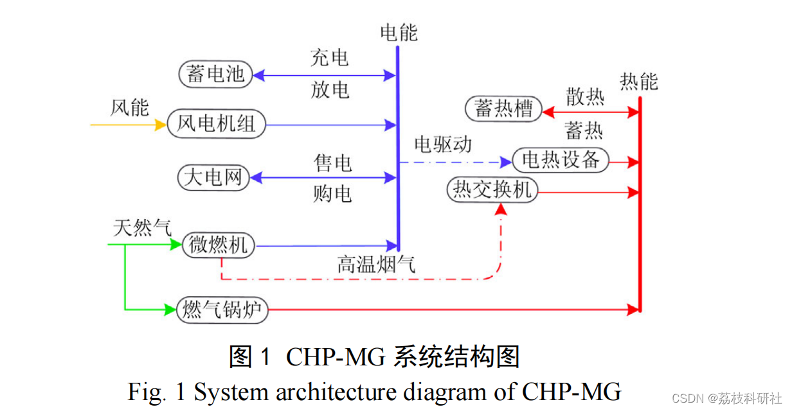
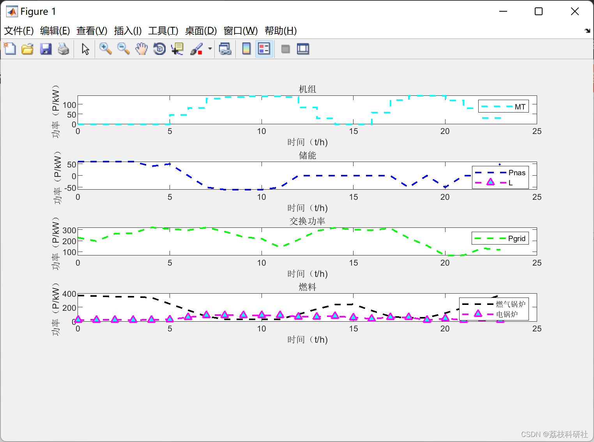
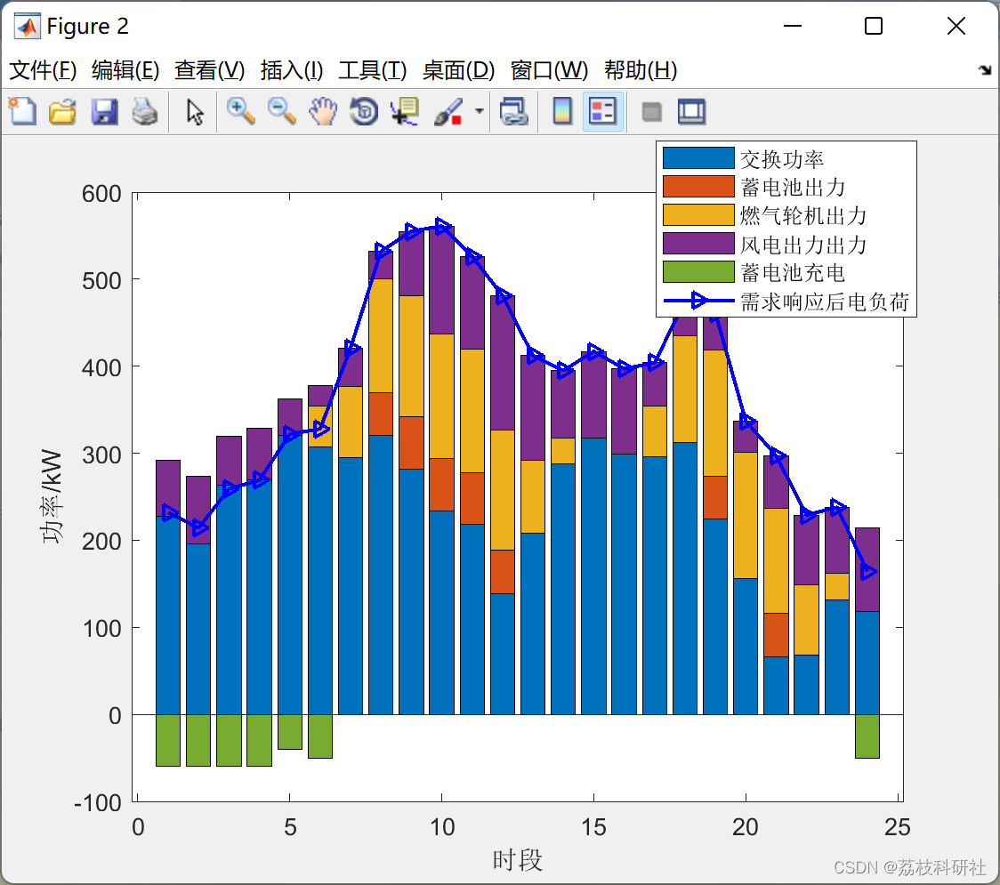
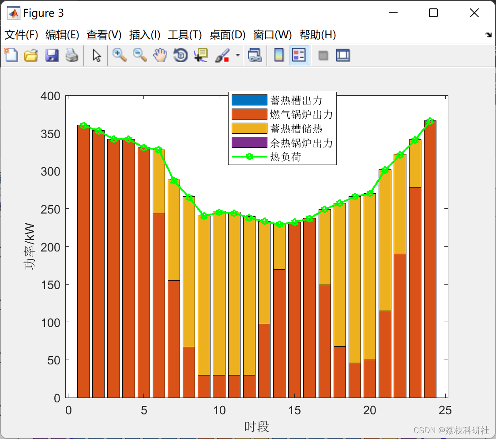
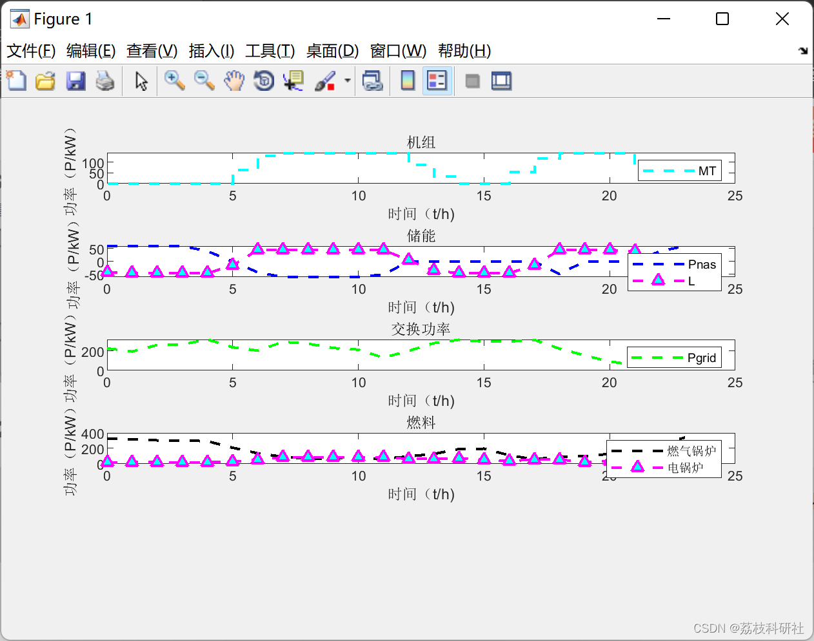
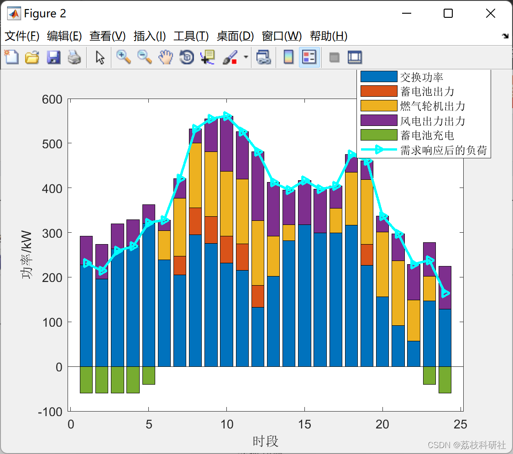
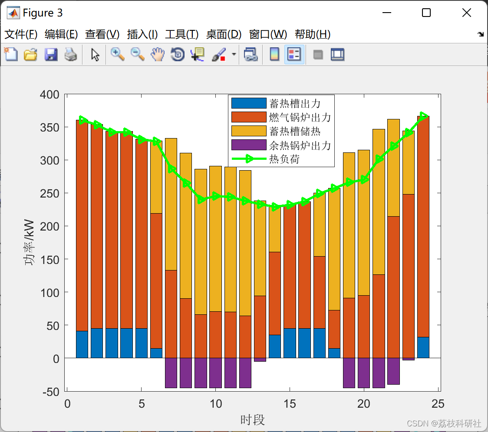

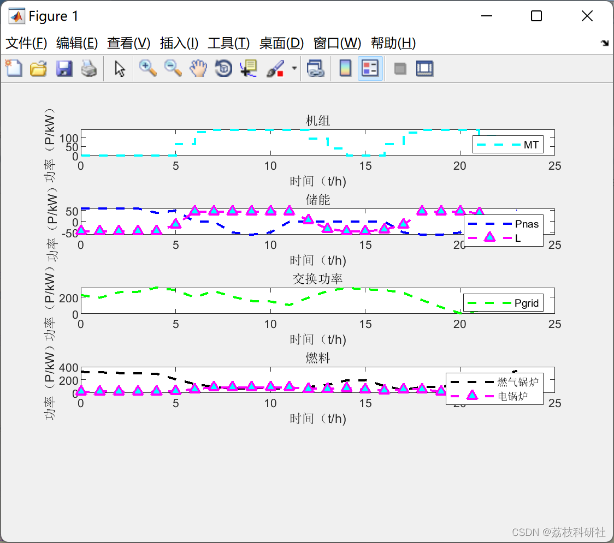
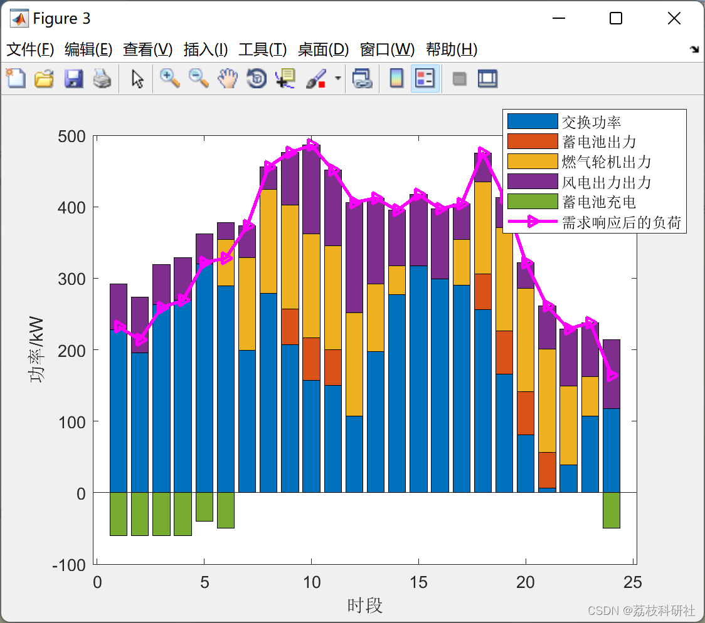

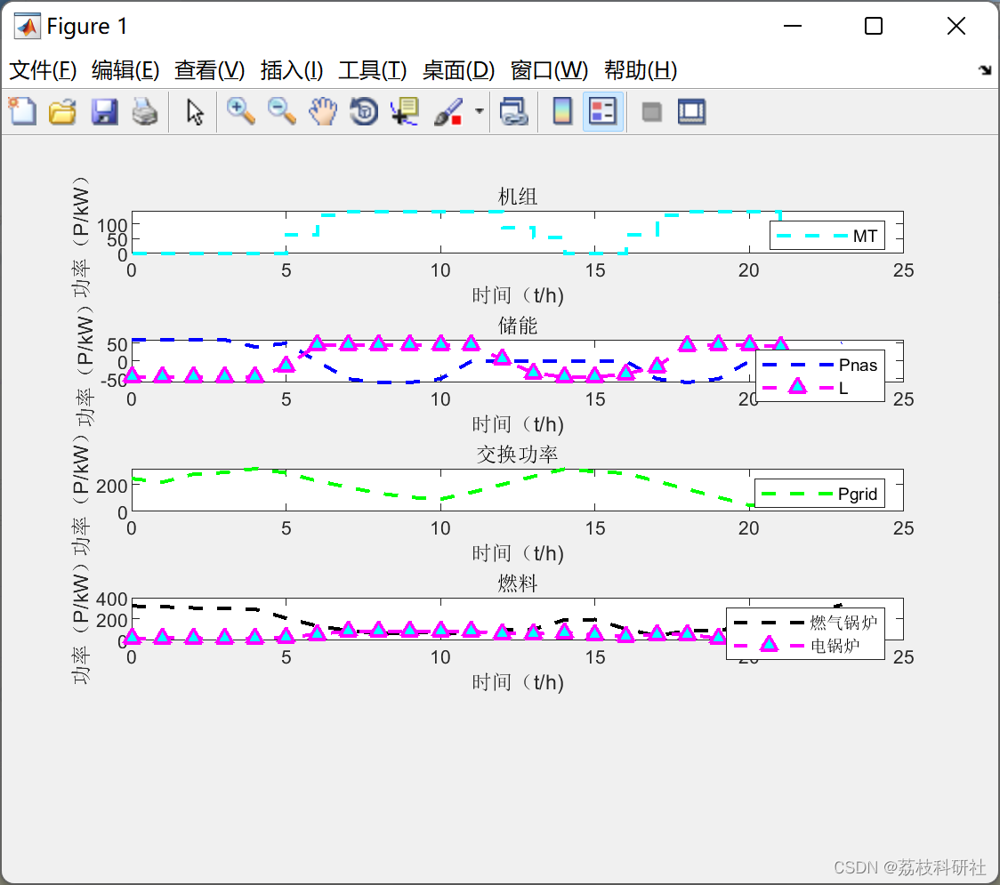
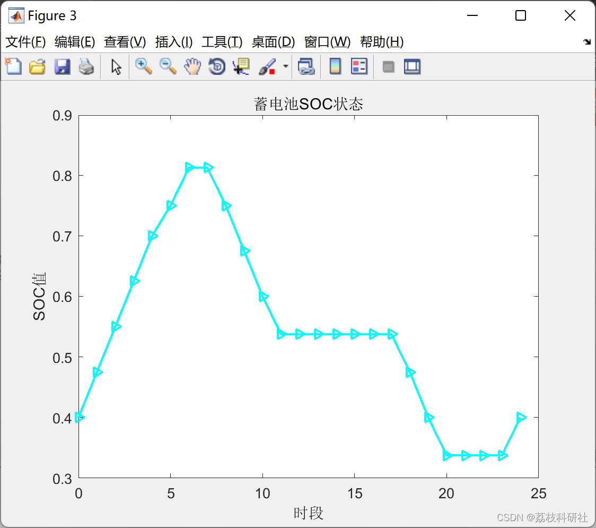
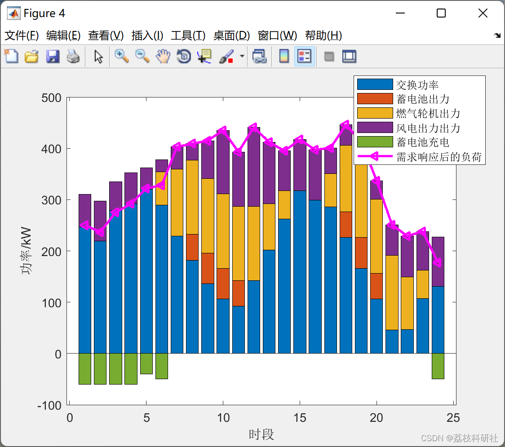

<!-- PAYMENT_BLOCK -->

## Get this dataset

- Payment link (Stripe): [Buy now](https://buy.stripe.com/3cs8yP7sY87d0vu9AB)
- Payment QR code: 

<!-- /PAYMENT_BLOCK -->
